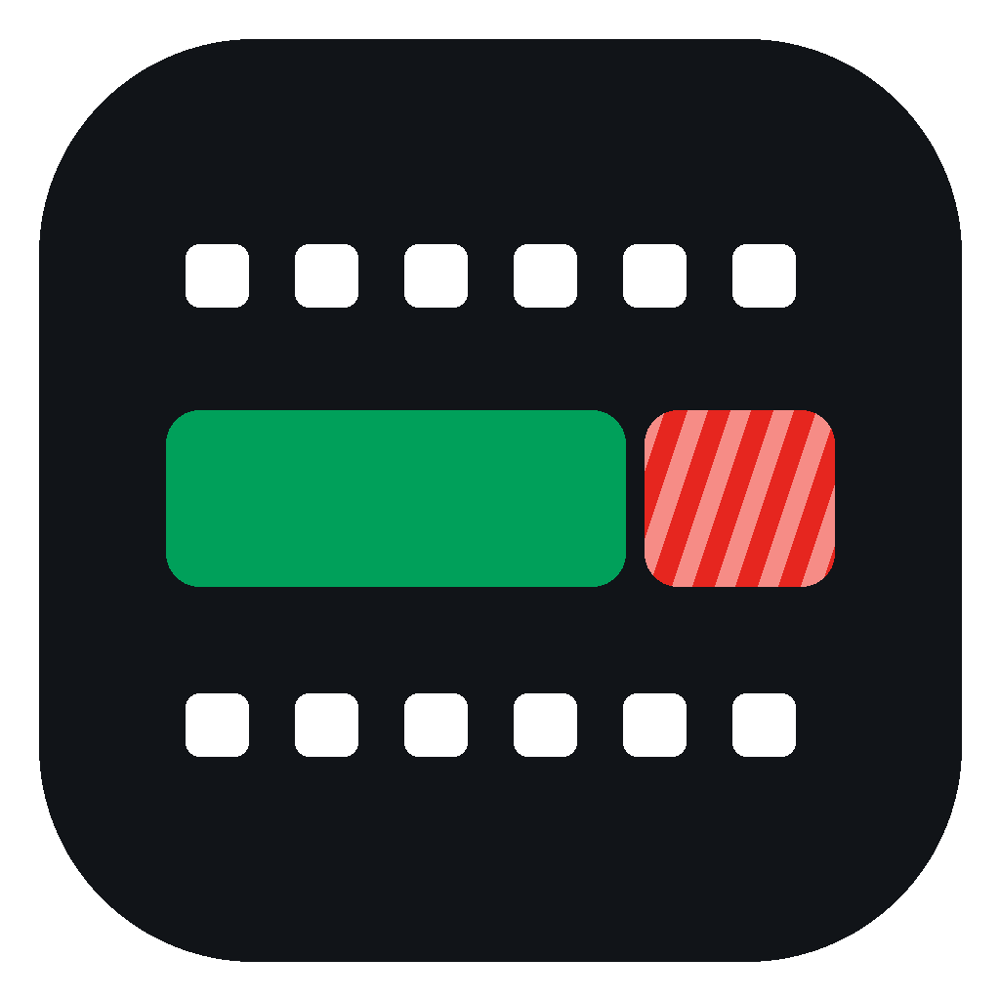
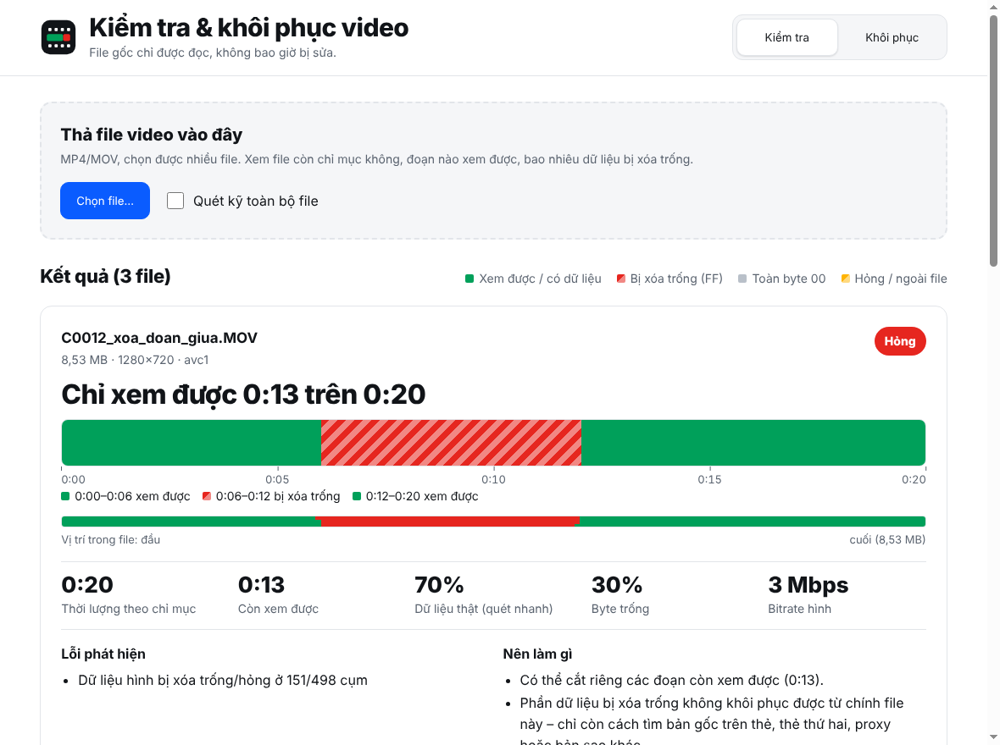

<p align="center"></p>

# Video Check: kiểm tra & khôi phục video

App mã nguồn mở cho **macOS** và **Windows** để kiểm tra lỗi file video MP4/MOV và **khôi phục file Sony XAVC bị mất chỉ mục**. Lỗi này thường gặp khi máy quay tắt đột ngột, thẻ nhớ hỏng hoặc copy dở, và file không mở được hoặc chỉ hiện một hình đứng yên.



## Tính năng

**Kiểm tra** (mọi file MP4/MOV)
- Kéo thả nhiều file cùng lúc, hoặc mở file bằng "Open with" từ Finder/Explorer.
- Cho biết file còn chỉ mục (moov) không, có bị cắt cụt không, phần đầu có bị xóa không.
- **Dòng thời gian**: đoạn nào còn xem được, đoạn nào dữ liệu đã bị xóa trống, với mốc thời gian cụ thể.
- **Bản đồ dữ liệu**: tỉ lệ dữ liệu thật so với byte trống (FF/00) theo vị trí trong file. Có chế độ quét kỹ đọc từng byte.
- Đọc metadata Sony: máy quay, số seri, ống kính, thời gian quay, định dạng ghi.
- Sao chép báo cáo dạng văn bản để gửi cho người khác.

**Khôi phục** (file MP4 Sony XAVC S / XAVC HS; đã thử trên Sony FX3)
- Dựng lại chỉ mục cho file mất chỉ mục hoặc mất phần đầu, dựa vào **một file tốt quay cùng máy, cùng cài đặt**.
- Tự bỏ qua vùng dữ liệu bị xóa trống rồi đi tiếp, không dừng giữa chừng.
- **File gốc chỉ được đọc, không bao giờ bị sửa.** Kết quả được ghi ra file mới.
- Báo trước nếu ổ đĩa không đủ chỗ trống. Có thể hủy giữa chừng; file tạm sẽ tự xóa.

## Tải về

Vào trang [**Releases**](../../releases/latest) và tải:

| Hệ điều hành | File |
|---|---|
| macOS chip Apple (M1–M4…) | `Video-Check-x.y.z-mac-arm64.dmg` |
| macOS chip Intel | `Video-Check-x.y.z-mac-x64.dmg` |
| Windows 10/11 (cài đặt) | `Video-Check-x.y.z-win-x64.exe` |
| Windows (chạy không cần cài) | `Video-Check-x.y.z-portable.exe` |

### Mở app lần đầu

App chưa được ký số bằng chứng chỉ trả phí của Apple/Microsoft, nên hệ điều hành sẽ cảnh báo:

- **macOS:** nhấp chuột phải vào app, chọn **Open**, rồi **Open** lần nữa. Hoặc vào *System Settings → Privacy & Security* và bấm **Open Anyway**. Nếu máy báo app "bị hỏng" (damaged), mở Terminal và chạy:
  ```
  xattr -cr "/Applications/Video Check.app"
  ```
- **Windows:** khi SmartScreen hiện ra, bấm **More info → Run anyway**.

## Cách dùng

### Kiểm tra
Thả file vào cửa sổ app, hoặc bấm **Chọn file…**. Quét nhanh chỉ mất vài giây mỗi file. Bật **Quét kỹ toàn bộ file** khi cần con số chính xác; với file vài chục GB, quét kỹ mất khoảng 1–3 phút.

### Khôi phục
1. Mở tab **Khôi phục**, hoặc bấm **Khôi phục file này…** trên thẻ kết quả của một file mất chỉ mục.
2. Chọn **file mẫu**: một file tốt quay bằng cùng máy, cùng độ phân giải, tốc độ khung hình và bitrate.
3. Chọn **file hỏng**, kiểm tra tên file mới, rồi bấm **Bắt đầu khôi phục**.
4. Khi xong, bấm **Kiểm tra file mới** để xem kết quả.

Ổ đĩa cần trống khoảng bằng dung lượng file hỏng.

### Giới hạn cần biết
- Phần dữ liệu đã bị **xóa trống** (toàn byte FF/00) **không thể lấy lại** từ chính file đó. Khi đó chỉ còn cách tìm bản gốc trên thẻ, thẻ thứ hai, file proxy hoặc bản sao khác.
- Khôi phục hiện chỉ hỗ trợ cấu trúc Sony XAVC: hình H.264/H.265, tiếng PCM và metadata `rtmd`.
- Mỗi chỗ đứt thường mất thêm khoảng nửa giây: chu kỳ ngay trước vùng hỏng và chu kỳ cuối cùng của file không xác định được điểm kết thúc.
- Phần kiểm tra đọc cấu trúc và dữ liệu thô, không giải mã từng khung hình. Một file được báo "Tốt" vẫn có thể có lỗi hình nhỏ bên trong.

## Dòng lệnh

Cần Node.js 20 trở lên. Chạy trong thư mục mã nguồn, không cần cài thêm gói nào:

```bash
node cli/video-check.js check video.MP4 --full            # kiểm tra (mã thoát 1 nếu có file hỏng)
node cli/video-check.js check *.MP4 --json                # xuất JSON
node cli/video-check.js repair mau.MP4 hong.MP4           # khôi phục → hong_khoi_phuc.MP4
node cli/video-check.js repair mau.MP4 hong.MP4 --dry-run # chỉ quét, không ghi file
```

## Phát triển

```bash
npm install
npm start          # chạy app
npm test           # kiểm thử (dùng file giả lập, không cần video thật)
npm run dist       # đóng gói cho hệ điều hành đang dùng → thư mục dist/
```

GitHub Actions tự chạy kiểm thử và build bản macOS và Windows mỗi lần đẩy code. Để phát hành bản mới:

```bash
npm version patch          # ví dụ 1.0.0 → 1.0.1
git push --follow-tags     # tag v1.0.1 → tự tạo Release kèm file cài đặt
```

### Cấu trúc mã nguồn

| Đường dẫn | Nội dung |
|---|---|
| `src/core/analyzer.js` | Phân tích file MP4/MOV (dùng được cả trong trình duyệt) |
| `src/core/repair.js` | Quét file hỏng và dựng lại chỉ mục Sony XAVC |
| `src/main.js`, `src/worker.js` | Electron: cửa sổ, hộp thoại, chạy việc nặng ở luồng riêng |
| `src/renderer/` | Giao diện |
| `cli/video-check.js` | Dòng lệnh |
| `test/` | Kiểm thử với file Sony XAVC giả lập |

### Cách khôi phục hoạt động
Máy Sony ghi dữ liệu theo chu kỳ: `[metadata rtmd × N][N khung hình][tiếng PCM]`, với N = 12 ở 25p. Chỉ mục (`moov`) được ghi **ở cuối file** khi dừng quay, nên máy tắt đột ngột hoặc thẻ hỏng sẽ làm mất nó. App đọc chỉ mục của file mẫu để biết bố cục, rồi quét file hỏng theo từng chu kỳ: nhận diện mẫu `rtmd`, đo từng khung hình qua các NAL unit (khung mới bắt đầu bằng AUD), xử lý cả đoạn đệm số 0 trước phần tiếng. Sau đó app dựng lại các bảng `stsz`, `co64`, `stss`, `ctts`, `stts` và thời lượng. Gặp vùng hỏng, app tìm chu kỳ hợp lệ kế tiếp để đi tiếp.

## English

**Video Check** is a free, open-source desktop app (macOS & Windows) that inspects MP4/MOV files and shows which parts are playable, which parts were blanked (0xFF/0x00) and whether the index (`moov`) is missing. It can also **rebuild the index of Sony XAVC recordings** that lost it after a power cut, card failure or interrupted copy, using a healthy reference clip shot on the same camera with the same settings (tested with Sony FX3). Source files are opened read-only; results are always written to a new file. UI is in Vietnamese. Download from [Releases](../../releases/latest); see the CLI section for command-line use.

## Giấy phép

[MIT](LICENSE). Sony, XAVC và tên các máy quay là nhãn hiệu của Sony Group Corporation. Dự án này không liên quan đến Sony.
